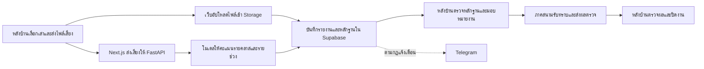
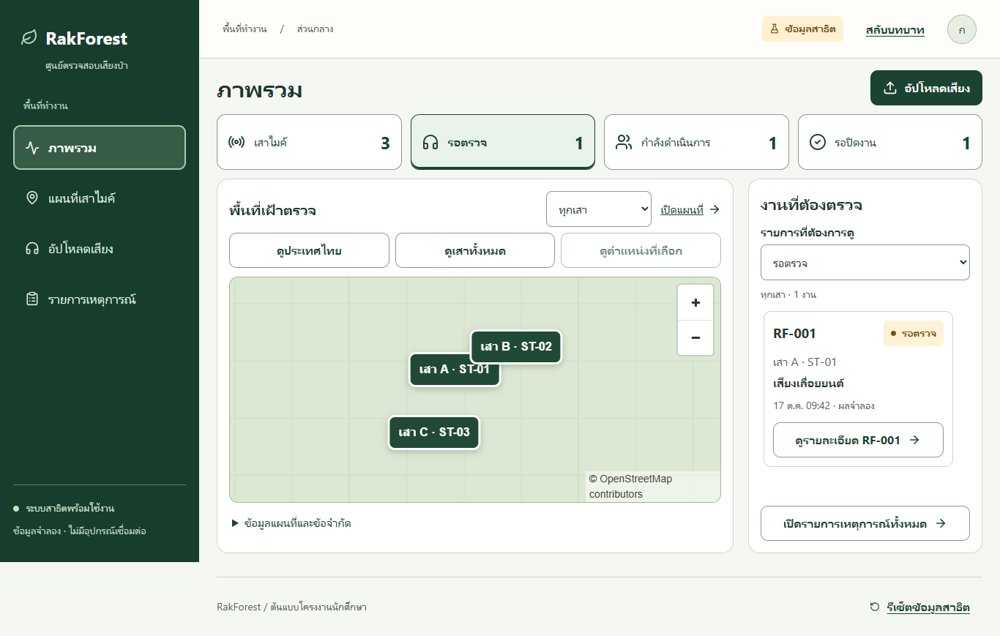
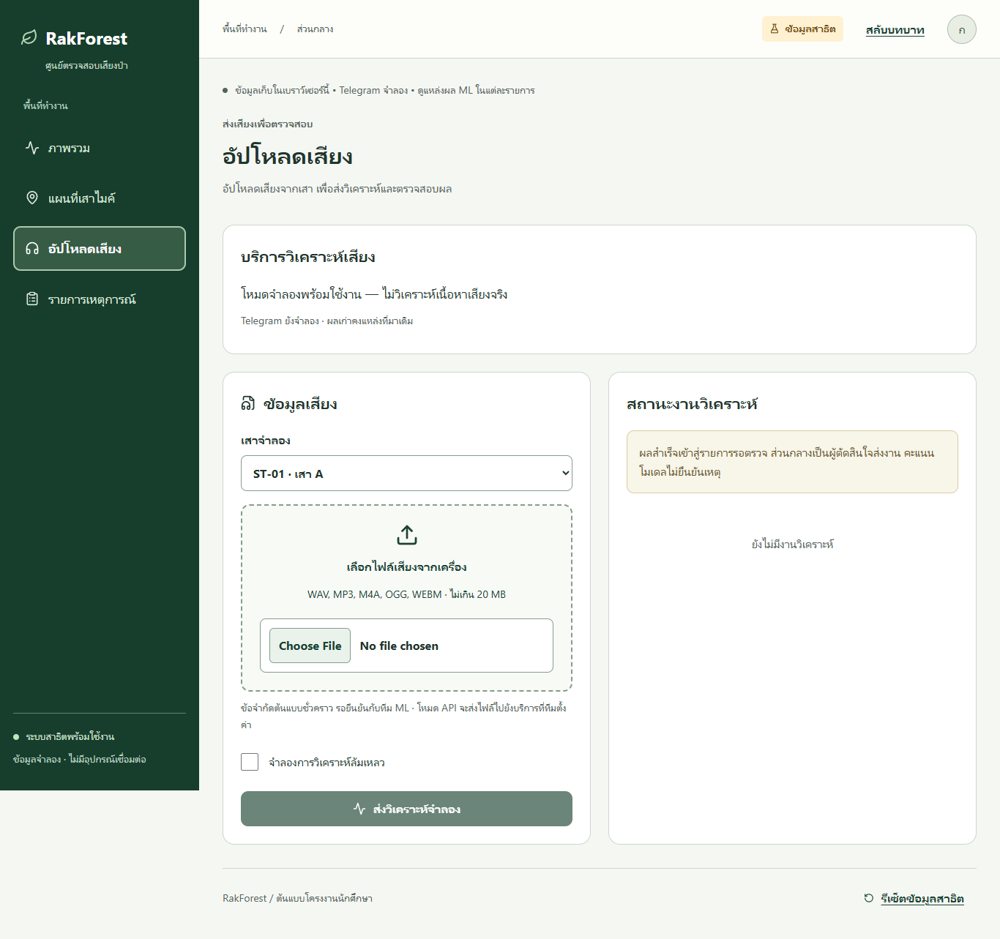
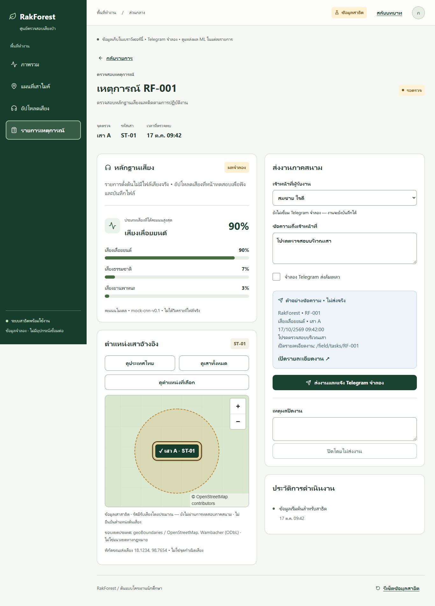
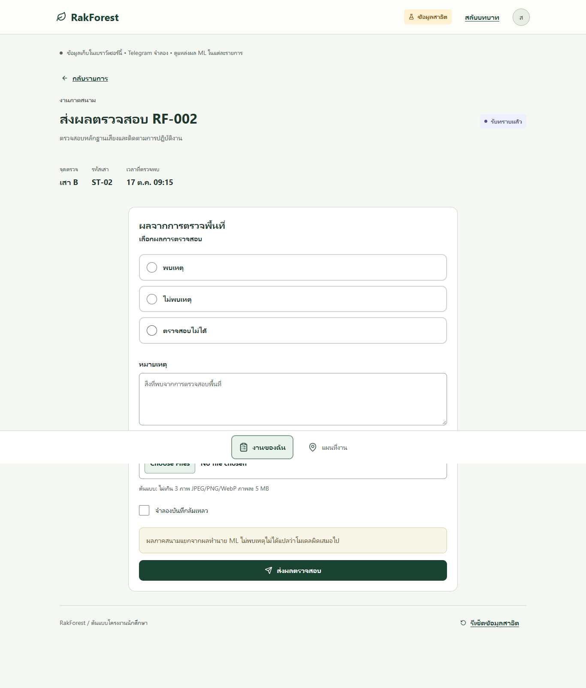
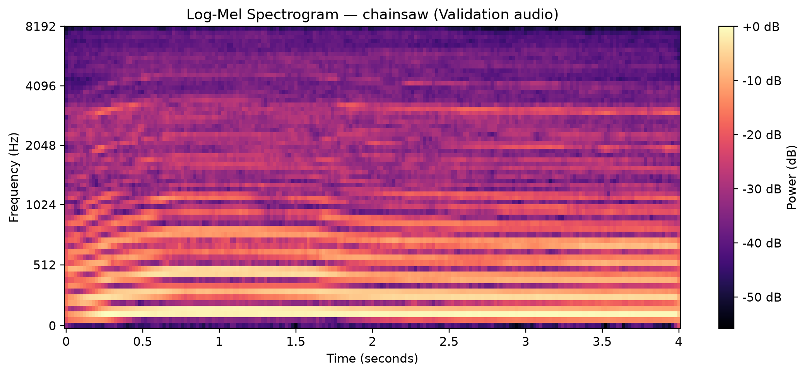

# คู่มืออ่านโค้ดและนำเสนอ RakForest

**RakForest ช่วยเจ้าหน้าที่คัดกรองเสียงจากจุดเฝ้าระวัง แล้วติดตามงานตั้งแต่ตรวจหลักฐานจนถึงปิดภารกิจ** เวลาอธิบายให้อาจารย์ฟัง ให้เล่าตามรายงานหนึ่งใบ เริ่มจากเลือกเสาและส่งเสียง ตามไปดูผล AI มอบหมายงาน รับผลจากภาคสนาม แล้วปิดงาน

## เส้นทางของรายงานหนึ่งใบ

| ส่วน | ให้จำว่า | เปิดโค้ดจาก |
| --- | --- | --- |
| หน้าจอเว็บ | หน้าใน `src/app` รับการกดปุ่ม ส่วน `src/components` มีแผนที่ เครื่องเล่นเสียง และกล่องแสดงผล | [หน้าหลังบ้าน](../src/app/%28backoffice%29) · [หน้าภาคสนาม](../src/app/%28field%29) · [คอมโพเนนต์](../src/components) |
| ตัวเชื่อมข้อมูล | `rakforestRepo` รวมงานอ่านและเขียนข้อมูล ส่งไฟล์ และเรียก API | [repository.ts](../src/lib/supabase/repository.ts) |
| เซิร์ฟเวอร์เว็บ | Route Handler รับไฟล์และคุยกับ FastAPI หรือจัดการแจ้งเตือน | [classify-audio](../src/app/api/classify-audio/route.ts) · [notifications/dispatch](../src/app/api/notifications/dispatch/route.ts) |
| ฐานข้อมูลและไฟล์ | Supabase เก็บรายงาน ผู้รับงาน เวลา และผลตรวจ ส่วน Storage เก็บไฟล์เสียงและหลักฐาน | [โครงสร้างฐานข้อมูล](../supabase/migrations/20261101000001_initial_schema.sql) · [ชนิดข้อมูลในเว็บ](../src/types/database.types.ts) |
| โมเดลเสียง | โน้ตบุ๊กฝึกและประเมิน ส่วน FastAPI โหลด checkpoint ที่ฝึกเสร็จแล้วสำหรับใช้กับเสียงใหม่ | [โน้ตบุ๊ก](../../notebooks) · [FastAPI](../../api_service/main.py) |

## ดูรูปแล้วตามหาว่าปุ่มอยู่ในโค้ดส่วนไหน

ภาพประกอบจากชุดทดสอบเว็บรุ่นสาธิตในโปรเจกต์ ใช้ชี้ตำแหน่งและหน้าที่ของแต่ละส่วน ชื่อเมนูและหน้าตาบางจุดเปลี่ยนในเว็บปัจจุบัน ให้ยึดเส้นทางและชื่อฟังก์ชันในตารางเวลาเปิดโค้ด

### 1. เข้าสู่ระบบ ภาพรวม และเลือกเสา

| หน้าและจุดที่ชี้ | โค้ดที่เปิด | อธิบายให้อาจารย์ฟัง |
| --- | --- | --- |
| `/login` ช่องเข้าสู่ระบบ | [`login/page.tsx`](../src/app/%28auth%29/login/page.tsx) เรียก `rakforestRepo.signIn` | เว็บใช้โปรไฟล์เลือกหน้าตามบทบาท ภาคสนามไปหน้า `/home` ส่วนหลังบ้านไป `/dashboard` |
| `/dashboard` ตัวเลขภาพรวมและรายการเหตุ | [`dashboard/page.tsx`](../src/app/%28backoffice%29/dashboard/page.tsx) ดู `loadAll` และ `kpis` | หน้าดึงโซน เสา และรายงาน แล้วนำข้อมูลมาคำนวณภาพรวม |
| `/dashboard` หรือ `/map` บริเวณหมุดและวงรัศมี | [`RiskZoneMap.tsx`](../src/components/map/RiskZoneMap.tsx) · [หน้าแผนที่](../src/app/%28backoffice%29/map/page.tsx) | หมุดแสดงตำแหน่งอ้างอิงของเสาหรือรายงาน วงแสดงพื้นที่โดยประมาณสำหรับช่วยวางแผนตรวจพื้นที่ |

### 2. หลังบ้านเลือกเสาและส่งเสียงให้ AI

| จุดที่ชี้ | โค้ดที่เปิด | จากการกดปุ่มไปถึงข้อมูล |
| --- | --- | --- |
| หน้ารายงาน `/reports` ส่วนเลือกเสาและโมเดล | [`reports/page.tsx`](../src/app/%28backoffice%29/reports/page.tsx) ดู `handleStationAudioSubmit` | เก็บเสาที่เลือกไว้เป็นบริบทของรายงาน แล้วส่งไฟล์และ `modelId` |
| จุดอัดเสียงและเลือกไฟล์ | [`AudioRecorder.tsx`](../src/components/reports/AudioRecorder.tsx) | ส่งไฟล์ที่เลือกหรืออัดกลับให้หน้าที่เรียกใช้ |
| ปุ่มวิเคราะห์ | [`repository.ts`](../src/lib/supabase/repository.ts) ดู `createReportWithAudio` และ `classifyReportAudio` | เริ่มอัปโหลดเสียงเข้า Storage และส่งเสียงวิเคราะห์พร้อมกัน รวบรวมผลก่อนบันทึกรายงาน |
| ส่วนที่คุยกับโมเดล | [`classify-audio/route.ts`](../src/app/api/classify-audio/route.ts) ดู `POST` | รับ `FormData` ส่งต่อไป FastAPI ตรวจรูปแบบคำตอบ และแปลงคะแนนเป็นระดับความเสี่ยง |

### 3. หลังบ้านตรวจหลักฐาน มอบหมาย และปิดงาน

หน้าในโค้ดปัจจุบันคือ [`/reports/[id]`](../src/app/%28backoffice%29/reports/%5Bid%5D/page.tsx) โดย `[id]` คือค่าที่เปลี่ยนตามรายงานแต่ละใบ

| จุดที่ชี้ | ฟังก์ชันหรือคอมโพเนนต์ | ความหมายในงาน |
| --- | --- | --- |
| หลักฐานเสียงด้านซ้าย | [`AudioWaveformPlayer`](../src/components/reports/AudioWaveformPlayer.tsx) · [`AIClassificationCard`](../src/components/reports/AIClassificationCard.tsx) | เปิดฟังเสียงและอ่านผลรายคลาสหรือรายช่วงที่โมเดลส่งกลับ |
| กล่องเลือกเจ้าหน้าที่และปุ่มมอบหมาย | `handleDispatch` → `dispatchToFieldRanger` ใน [repository.ts](../src/lib/supabase/repository.ts) | บันทึกผู้รับและคำสั่งลงรายงาน แล้วแสดงผลการส่ง Telegram แยกจากผลมอบหมาย |
| ส่วนผลการลงพื้นที่ | `field_outcome`, `field_notes`, `submitted_at` ใน [ReportRecord](../src/types/database.types.ts) | หลังบ้านใช้ผลตรวจของเจ้าหน้าที่เทียบกับหลักฐานที่มี |
| ปุ่มยืนยันเหตุ ตรวจผล และปิดงาน | `handleReview` → `reviewReportStatus` และ [`canCloseReport`](../src/lib/report-workflow.ts) | ยืนยันเหตุบันทึกคำตัดสิน หลังส่งผลต้องบันทึกว่าตรวจผลแล้วจึงปิดงานได้ กรณีปฏิเสธเหตุที่ยังไม่เคยมอบหมายปิดได้จากการตรวจของหลังบ้าน |
| ข้อความใกล้ปุ่ม | [`ActionFeedback.tsx`](../src/components/reports/ActionFeedback.tsx) | แสดงสถานะกำลังทำ สำเร็จ หรือข้อผิดพลาดตรงจุดที่ผู้ใช้กด |

### 4. ภาคสนามรับงานและส่งผลตรวจในภารกิจเดิม

| หน้าและจุดที่ชี้ | โค้ดที่เปิด | จากการกดปุ่มไปถึงข้อมูล |
| --- | --- | --- |
| `/home` การ์ดภารกิจด่วน | [`home/page.tsx`](../src/app/%28field%29/home/page.tsx) ดู `urgentStationTasks` | เลือกงานที่รับทราบได้หรืองานที่กำลังดำเนินการมาแสดง |
| `/field-reports` แท็บภารกิจและงานปิด | [`field-reports/page.tsx`](../src/app/%28field%29/field-reports/page.tsx) ดู `filtered` | งานที่ยังเปิดรวมถึงงานที่ส่งผลแล้วและรอตรวจ งานจะย้ายแท็บเมื่อปิด |
| `/field-reports/[id]` ปุ่มรับทราบและฟอร์มส่งผล | [`field-reports/[id]/page.tsx`](../src/app/%28field%29/field-reports/%5Bid%5D/page.tsx) ดู `handleAcknowledge` และ `handleSubmitInspection` | รับทราบก่อนเห็นฟอร์ม ส่งผลว่าเจอเหตุ ไม่พบเหตุ หรือตรวจไม่ได้ พร้อมหมายเหตุ |
| `/report/new` ฟอร์มแจ้งเหตุใหม่ | [`report/new/page.tsx`](../src/app/%28field%29/report/new/page.tsx) · [คิวออฟไลน์](../src/lib/offline/report-queue.ts) | ใช้สร้างรายงานจากการลาดตระเวน หากออฟไลน์ คิวปัจจุบันเก็บข้อมูลรายงานกับเสียงไว้บนอุปกรณ์เพื่อส่งภายหลัง |

จุดสำคัญในโค้ดคือ [`fieldTaskStage`](../src/lib/report-workflow.ts) อ่านเวลาจากรายงาน `acknowledged_at` บอกว่ารับงานแล้ว `submitted_at` บอกว่าส่งผลแล้ว และ `reviewed_at` ใช้แยกผลที่หลังบ้านตรวจแล้ว ในขณะที่ `status` ยังเก็บคำตัดสินอย่าง `confirmed` ได้ ดังนั้นกดยืนยันเหตุจริงแล้วภาคสนามยังทำงานต่อได้ พอปิดงานจึงย้ายไปรายการปิดงาน

### หน้าตั้งค่าและโค้ดที่ใช้ร่วมกัน

| ถ้าต้องการหา | เริ่มที่ไหน |
| --- | --- |
| บัญชีและการยืนยันผู้ใช้ | [`/accounts`](../src/app/%28backoffice%29/accounts/page.tsx) · [`/verify`](../src/app/%28auth%29/verify/page.tsx) · [บริการบัญชี](../src/lib/accounts/service.ts) |
| เพิ่มโซนหรือจัดการเสา | [`/zones`](../src/app/%28backoffice%29/zones/page.tsx) · [ตัวอ่านและบันทึกเสากับโซน](../src/lib/directory/service.ts) |
| ตั้งค่า Telegram และรัศมีแจ้งเตือน | [`/settings/alerts`](../src/app/%28backoffice%29/settings/alerts/page.tsx) · [API ส่งแจ้งเตือน](../src/app/api/notifications/dispatch/route.ts) |
| หน้าตาเมนูหลักและสลับภาษา | [Layout หลังบ้าน](../src/app/%28backoffice%29/layout.tsx) · [Layout ภาคสนาม](../src/app/%28field%29/layout.tsx) · [ตัวจัดการภาษา](../src/lib/i18n/language.tsx) |

## โมเดลเสียงทำงานอย่างไร

1. **เตรียมข้อมูลเพื่อฝึก** โน้ตบุ๊ก 01 นำข้อมูลเข้า ส่วน 02 ตรวจและจัดป้าย แบ่งชุดฝึก ชุดตรวจระหว่างพัฒนา และชุดทดสอบตามกลุ่มของไฟล์บันทึก เพื่อลดโอกาสที่ช่วงเสียงจากไฟล์ต้นทางเดียวกันไปอยู่คนละชุด [ดาวน์โหลดข้อมูล](../../notebooks/01_download_datasets.ipynb) · [EDA และเตรียมข้อมูล](../../notebooks/02_eda_cleaning.ipynb)
2. **ฝึกและเปรียบเทียบรุ่น** CNN แบบ Softmax ให้คะแนนสำหรับเลือกคลาสหลัก ส่วน CNN และ CRNN แบบ Sigmoid ให้คะแนนแต่ละคลาสแยกกัน จึงรองรับเสียงหลายประเภทในช่วงเดียวกัน CRNN ใช้ convolution อ่านรูปแบบบนภาพเสียงและ recurrent layer อ่านลำดับเวลา [ฝึก CNN](../../notebooks/03_train_model.ipynb) · [เปรียบเทียบสามรุ่น](../../notebooks/07_single_vs_multi_model_comparison.ipynb) · [ฝึก CRNN](../../notebooks/09_train_crnn_sigmoid.ipynb)
3. **วิเคราะห์ไฟล์ใหม่** `GET /health` ตรวจว่าบริการและโมเดลพร้อม ส่วน `POST /analyze` อ่านเสียงเป็น mono ปรับอัตราสุ่มตามโมเดล แบ่งช่วงละ 4 วินาที แล้วแปลงเสียงเป็น log-Mel spectrogram ก่อนส่งเข้าโมเดล ไฟล์สั้นถูกเติมให้ครบช่วง [ลองกับเสียงใหม่ในโน้ตบุ๊ก](../../notebooks/05_infer_new_audio.ipynb) · [FastAPI](../../api_service/main.py)
4. **สรุปผลสำหรับหน้าจอ** FastAPI ส่งคะแนนรายช่วงและใช้ค่าสูงสุดของแต่ละคลาสข้ามช่วงสรุประดับไฟล์ เว็บนำคะแนนไปผ่านกฎสีอีกชั้น สำหรับ Sigmoid กลุ่มภัยสำคัญมีเกณฑ์แดงที่ `0.75` และเหลืองที่ `0.45` ส่วนยานพาหนะหรือกิจกรรมมนุษย์ใช้เกณฑ์เหลือง `0.60` Softmax ใช้ระดับตามคลาสที่ชนะ คะแนนช่วยจัดลำดับการตรวจ และเจ้าหน้าที่เป็นผู้ตัดสินว่าเกิดเหตุจริงหรือไม่ [กฎระดับความเสี่ยง](../src/lib/utils/risk.ts)

### ถ้าอาจารย์ถามผลประเมิน

| รุ่นในรายงานเปรียบเทียบ | Validation macro-F1 |
| --- | ---: |
| Single-label CNN | 0.852 |
| Multi-label CNN Candidate | 0.746 |
| CRNN + Sigmoid | 0.797 |

อธิบายว่า macro-F1 เฉลี่ยคะแนน F1 โดยให้ทุกคลาสมีน้ำหนักเท่ากัน ตัวเลขมาจาก validation ที่บันทึกไว้และโจทย์ single-label กับ multi-label ต่างกัน จึงควรอธิบายโจทย์ของแต่ละรุ่นก่อนเทียบคะแนน สำหรับการประเมินชุดทดสอบให้เปิดโน้ตบุ๊กประเมินเฉพาะรุ่น [ผล validation ที่บันทึกไว้](../../reports/single_multi_crnn_validation_comparison.json) · [ประเมิน CNN](../../notebooks/04_evaluate_model.ipynb) · [ประเมิน CRNN](../../notebooks/10_evaluate_crnn_sigmoid.ipynb)

## ข้อมูลไปอยู่ที่ไหน และ Telegram ส่งตอนไหน

- **Supabase** เก็บรายงานใน `reports` เสาใน `sensor_stations` พื้นที่ใน `forest_zones` และโปรไฟล์ใน `profiles` ผลเสียงเชื่อมจาก `report_audio` ไป `ai_classifications` และไฟล์อยู่ใน Storage เว็บมีข้อมูลสำรองในเบราว์เซอร์สำหรับบางเส้นทางด้วย [Schema SQL](../supabase/migrations/20261101000001_initial_schema.sql) · [ตัวอ่านและเขียนข้อมูล](../src/lib/supabase/repository.ts)
- **โหมดสำรองของหน้ารายงาน** เมื่อ FastAPI ใช้งานไม่ได้ `/api/classify-audio` สร้างผลที่ระบุ `source: fallback` และหน้ารายละเอียดติดป้ายผลจำลอง ส่วนผลจาก API ที่ตอบกลับและผ่านการตรวจใช้ `source: http` ในโค้ดยังมี `/api/ml/analyze` และ `demo-service.ts` สำหรับเส้นทางเดโมอีกชุด เมื่ออ่านหน้ารายงานปัจจุบันให้เริ่มจาก `/api/classify-audio` [Route ปัจจุบัน](../src/app/api/classify-audio/route.ts) · [Route เดโม](../src/app/api/ml/analyze/route.ts)
- **Telegram อัตโนมัติ** เส้นทางบันทึกรายงานตรวจว่าผลมาจากโมเดลจริงและความเสี่ยงเป็นแดงหรือเหลือง แล้วให้ API ตรวจว่ากฎเปิด Telegram หรือไม่ และเลือกเจ้าหน้าที่ตามโซนหรือรัศมีพร้อมบัญชีที่ผูกไว้ อีกเส้นทางคือการส่งที่เลือกได้จากหน้ามอบหมายงาน [Route แจ้งเตือน](../src/app/api/notifications/dispatch/route.ts) · [กฎเลือกผู้รับ](../supabase/migrations/20261122000001_field_alert_radius.sql)

## ซ้อมเล่าให้อาจารย์ฟังในหนึ่งนาที

> RakForest ทำขึ้นเพื่อช่วยคัดกรองเสียงจากจุดเฝ้าระวังและลดเวลาที่เจ้าหน้าที่ต้องไล่ฟังเอง ตอนสาธิตผมเลือกเสาและอัปโหลดไฟล์เสียง เว็บส่งไฟล์ไปให้โมเดลแบ่งเป็นช่วง แล้ววิเคราะห์ว่ามีเสียงแบบไหนและน่าตรวจแค่ไหน ผลพร้อมหลักฐานจะอยู่ในรายงานบน Supabase หลังบ้านเปิดฟังและเลือกมอบหมายเจ้าหน้าที่ ภาคสนามรับงานและส่งผลตรวจกลับมา หลังบ้านตรวจผลและปิดงานเมื่อดำเนินการครบ การยืนยันเหตุจริงจึงเป็นคนละขั้นกับการปิดภารกิจครับ

| คำถามที่อาจารย์อาจถาม | คำตอบสั้น ๆ |
| --- | --- |
| ทำไมต้องเปลี่ยนเสียงเป็น spectrogram? | เพื่อให้โมเดลมองเห็นรูปแบบความถี่ที่เปลี่ยนตามเวลา เช่น เสียงเครื่องยนต์ที่ต่อเนื่องกับเสียงสั้นเป็นช่วง ๆ |
| AI บอกตำแหน่งต้นเสียงได้ไหม? | พิกัดที่แสดงมาจากเสาหรือพิกัดที่บันทึกกับรายงาน วงบนแผนที่เป็นบริเวณอ้างอิงสำหรับตรวจพื้นที่ |
| ถ้า AI บอกว่าเป็นเหตุแล้วต้องปิดงานเลยไหม? | AI ให้ข้อมูลคัดกรอง หลังบ้านตรวจหลักฐานและภาคสนามส่งผล การปิดเป็นขั้นหลังตรวจผลและจัดการงานที่เกี่ยวข้องครบ |
| ถ้าผลจำลองขึ้นบนจอควรพูดอย่างไร? | บอกตรง ๆ ว่ากำลังสาธิตการไหลของงานเว็บ ส่วนการวิเคราะห์เสียงจริงต้องมี FastAPI พร้อม checkpoint |
| วิธีพิสูจน์ว่าขั้นตอนเว็บทำงานคืออะไร? | ทดสอบจากหน้าหลังบ้านไปภาคสนามจนปิดงานด้วย Playwright แล้วเดโมซ้ำกับบัญชีและข้อมูลจริงเมื่อมีสภาพแวดล้อมพร้อม |

## จุดที่ควรพูดให้ตรงกับสิ่งที่ทดสอบแล้ว

- โฟลว์ภารกิจและการอัปโหลดมีการทดสอบที่จำลอง Supabase, Storage หรือ Telegram ตามกรณี ขณะตรวจคู่มือนี้ บิลด์ล่าสุดและชุดทดสอบที่เกี่ยวข้องผ่าน 16 รายการ ตัวเลขนี้หมายถึงชุดทดสอบเว็บที่รัน [ทดสอบภารกิจและการอัปโหลด](../tests/report-actions.spec.ts) · [ทดสอบ Telegram](../tests/notifications.spec.ts) · [ทดสอบ API โมเดล](../tests/ml-server.spec.ts)
- การรับไฟล์ในเดโมเป็นการอัปโหลดจากผู้ใช้ ฮาร์ดแวร์เสาและการส่งเสียงอัตโนมัติเป็นขอบเขตต่อยอด บนเครื่องที่เปิดเว็บล่าสุดยังขาดแพ็กเกจ Python และ checkpoint สำหรับวิเคราะห์จริง [วิธีรัน FastAPI](../../api_service/README.md)
- หน้าภาคสนามยังต้องเพิ่มการรับแจ้งเตือนสดข้ามเครื่อง ส่วนการอัปโหลดเร็วขึ้นได้รับการยืนยันเรื่องเริ่มงานพร้อมกันจากการจำลอง เวลาใช้งานจริงขึ้นอยู่กับเครือข่าย ขนาดไฟล์ และเวลาโมเดล รายการรูปที่แนบตอนส่งผลตรวจภารกิจยังต้องผูกกับรายงานในฐานข้อมูลให้หลังบ้านเห็นข้ามเครื่อง [หน้าภาคสนาม](../src/app/%28field%29/field-reports/page.tsx) · [การบันทึกผลตรวจ](../src/lib/supabase/repository.ts)

**ลำดับอ่านเมื่อมีเวลา 15 นาที** อ่านแผนภาพก่อน เปิดโค้ด `handleStationAudioSubmit` แล้วค้นหา `createReportWithAudio` จากนั้นเปิด `fieldTaskStage` คู่กับหน้าภาคสนาม ลองอธิบายแต่ละช่วงว่าใครกดปุ่ม ระบบส่งอะไร และใครทำงานต่อ
